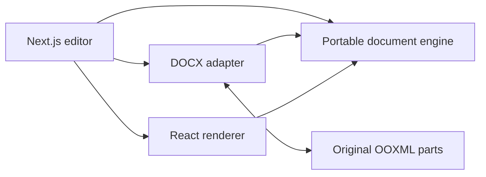

# DOCX IR Engine & Web Editor

**An experimental Word-style document editor for the browser, powered by a reusable TypeScript document engine and a source-preserving DOCX adapter.**

Open, edit, and download `.docx` documents in a Next.js workspace. The project separates document state and editing commands from Word's XML format and from the React interface. It pays particular attention to mixed **English and right-to-left (RTL) Persian/Arabic** text, fonts, styles, and document structure.

> **Project status — active development.** This is **not** a drop-in replacement for Microsoft Word. Common editing operations work, and edited DOCX export is implemented, but Word layout fidelity, imported complex objects, and some advanced formatting remain approximate or restricted. **Keep a backup of important documents and verify exported files in Word.** See [feature status](docs/feature-status.md) and [known limitations](docs/limitations.md).

## What it can do

- **Edit documents:** create a blank document or open an existing DOCX; type, select, format, find/replace, undo/redo, and download an edited DOCX.
- **Format text and paragraphs:** styles, fonts, RTL/LTR direction, alignment, spacing, indentation, lists, and basic text effects.
- **Work with structure:** tables, headers and footers, sections, page settings, and page-number fields within the implemented subset.
- **Insert content:** images, hyperlinks, comments, shapes, text boxes, equations, and selected chart and embedded-object types. Some features are experimental.
- **Use a familiar interface:** File, Home, Insert, and Layout ribbons, contextual object/table tools, page ruler, navigation, and property panes.
- **Build on the engine:** use the format-independent `/core`, Word-specific `/docx`, or presentation-only `/react` entry points separately.

The original DOCX package is retained by the editing session. **An unchanged document exports as its original bytes**; supported edits rewrite selected content while preserving unrelated package parts where possible. This does **not** guarantee that arbitrary Word content can be edited safely.

## Quick start

**Requirements:** Node.js **20.9+** and **pnpm** (lockfile v9; pnpm 9+ recommended).

```bash
# From the repository root
pnpm install --frozen-lockfile
pnpm dev
```

Open **http://127.0.0.1:3000**. The app loads a bundled demonstration document initially. Use **File → Open** for a local `.docx`, or create a new document. Choose **Download DOCX** to save a copy of your edits. Documents are processed in the browser; the workspace does not implement document-upload or cloud-storage services. **Online video embeds and external links can contact third-party services when used.**

### Other commands

| Command | What it does |
| --- | --- |
| `pnpm dev` | Build the engine and start the Next.js development server |
| `pnpm build` | Build engine and production web app |
| `pnpm start` | Start the already-built production web app |
| `pnpm build:engine` | Compile the reusable engine to `dist/` |
| `pnpm typecheck` | Type-check engine and application |
| `pnpm test` | Run the Vitest test suite |
| `node scripts/create-sample.mjs` | Regenerate the bundled sample document |
| `node scripts/benchmark-engine.mjs` | Run a core benchmark after building the engine |

During development, **re-run `pnpm build:engine` when changing `src/`** so the web workspace can load the updated package. See [Getting started](docs/getting-started.md) for setup, troubleshooting, and verification.

## Repository structure

```text
apps/web/          Next.js document editor, ribbons, dialogs, and browser editing
src/core/          Format-independent document model, commands, styles, history
src/docx/          DOCX import/export, OOXML preservation and package handling
src/model/         Shared document IR and graphics types
src/react/         React rendering and measured page layout
tests/             Vitest unit, adapter, regression and integration tests
scripts/           Sample tools and benchmarks
docs/              Documentation, implementation notes and compatibility research
```



The core uses `@electric-sql/d2ts` for incremental style-dependency tracking. It is not a database service; the app requires **no database, account, or server-side document store** for its local workflow.

## Use the engine in your own code

This repository is a **private workspace package, not a published npm package**. Build it first, then use its workspace exports (or package it yourself). A minimal DOCX edit/export:

```ts
import { openDocxSession } from "@local/docx-ir-engine/docx";
import { getParagraphs } from "@local/docx-ir-engine/core";

const input = await file.arrayBuffer(); // A File provided by your host app
const session = await openDocxSession(input);
const paragraph = getParagraphs(session.document.blocks)[0];

if (paragraph?.id && session.capability(paragraph.id).text) {
  await session.execute({
    type: "text",
    id: paragraph.id,
    start: 0,
    end: 0,
    text: "Hello ",
  });
}

const output: Uint8Array = await session.exportDocx();
// Save `output` in your host app, for example as an application/vnd... Blob.
```

**Important:** Word editing uses an `openDocxSession` to retain original package parts. A `createDocumentEngine()` snapshot by itself is not a preservation archive. For previews without editing, `importDocx()` and `DocumentRenderer` are also available. See [API and integration](docs/api.md) and [architecture](docs/engine-architecture.md).

## Documentation

| Guide | Description |
| --- | --- |
| [Documentation index](docs/README.md) | Start here to find all guides and research notes |
| [Getting started](docs/getting-started.md) | Installation, commands, troubleshooting |
| [Using the editor](docs/using-editor.md) | Open/edit/save workflow and UI features |
| [Feature status](docs/feature-status.md) | Implemented, partial and experimental functionality |
| [Known limitations](docs/limitations.md) | Compatibility, security and layout boundaries |
| [API and integration](docs/api.md) | Public package entry points and integration examples |
| [Engine architecture](docs/engine-architecture.md) | Core state, d2ts dependency graph, OOXML preservation |
| [Home ribbon status](docs/home-editor-status.md) | Home functionality and remaining gaps |
| [Insert/Layout status](docs/ribbon-status.md) | Insert/Layout and contextual editing features |
| [Contributing](CONTRIBUTING.md) | Development and pull-request guidelines |
| [Security](SECURITY.md) | Security limitations and reporting guidance |
| [Publishing on GitHub](docs/publishing.md) | Public-release checklist and suggested About text |

## Testing and compatibility

Run the full local checks before submitting changes:

```bash
pnpm typecheck
pnpm test
pnpm build
```

The repository includes regression tests for core editing, OOXML package handling, preservation, styles, tables, rendering and authoring. Some advanced objects have targeted Microsoft Word interoperability checks documented in [Insert/Layout status](docs/ribbon-status.md); **these are not broad Word-version or browser certifications**. Real-document and cross-platform validation is still needed.

## Contributing and license

Contributions, small reproducible DOCX test cases, and bug reports are welcome; please read [CONTRIBUTING.md](CONTRIBUTING.md). **Do not post private, confidential, or copyrighted documents as public test fixtures without permission.**

Project code is under the [MIT License](LICENSE). Locally included Fluent System Icons are separately licensed and credited in [`apps/web/public/icons/fluent/`](apps/web/public/icons/fluent/README.md). This project is independent of, and not endorsed by, Microsoft.
