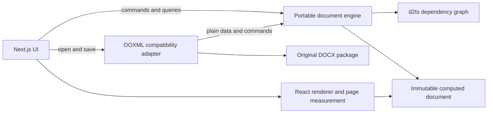

# Document engine architecture and review

Reviewed and implemented on 2026-11-05. The existing parser, source-retaining editing session, rendering layer, Next.js host, and their tests were traced together. This document supersedes the architectural assessment in the historical `engine-review.md`; the compatibility matrix still describes the supported Word feature subset.

## Findings and changes

| Finding                                         | Previous consequence                                                                                                 | Current boundary                                                                                                                                                      |
| ----------------------------------------------- | -------------------------------------------------------------------------------------------------------------------- | --------------------------------------------------------------------------------------------------------------------------------------------------------------------- |
| XML was the editable state                      | Typing and formatting parsed and serialized document parts, then reparsed the package to compute display properties. | `DocumentEngine` owns immutable document state, commands, styles, history, and derived text data. Common DOCX edits change this state and queue compatibility writes. |
| Editing contracts lived under `docx/session.ts` | UI and reusable editing behavior depended on a format-specific module.                                               | `core/types.ts` defines `DocumentSession`, `DocumentStyle`, and `EditCommand`. The Word session extends this contract with file operations.                           |
| The IR exposed mostly computed formatting       | Style updates could confuse direct formatting, defaults, table contributions, and script-specific fonts.             | Authored run/paragraph properties, container context, paragraph-mark properties, list-marker properties, and computed properties are separate plain data.             |
| Style updates used a UI formatting snapshot     | A neighboring run could supply the wrong color; Persian paragraph direction could leak into Normal.                  | Selection-style updates run in the core over explicit text offsets. Shared character differences update the style; local paragraph layout is edited explicitly.       |
| Derived properties were repeatedly scanned      | Word counts, search results, and style changes did work for unrelated paragraphs.                                    | d2ts tracks style dependencies. Text counts and the active search are updated from changed paragraph text. The UI consumes these results.                             |
| No executable dependency boundary               | Future changes could accidentally pull XML or React into the engine.                                                 | `architecture.test.ts` checks the transitive core import graph and the reusable editor components.                                                                    |

## Layers

| Entry point                   | Responsibilities                                                                                                                                                                         | Excluded responsibilities                                                                                    |
| ----------------------------- | ---------------------------------------------------------------------------------------------------------------------------------------------------------------------------------------- | ------------------------------------------------------------------------------------------------------------ |
| `@local/docx-ir-engine/core`  | Portable model, text/run/paragraph edits, styles and inheritance, list definitions, structural commands, page data, search, counts, snapshots, atomic batches, undo/redo, subscriptions. | XML, ZIP, relationships, source-part preservation, React, browser selection, font loading, page measurement. |
| `@local/docx-ir-engine/docx`  | OPC/OOXML import/export, themes and Word-specific interpretation, protected/opaque content, source mappings and preservation.                                                            | Menus, browser selection, CSS, authoritative text/style state.                                               |
| `@local/docx-ir-engine/react` | Render the computed model, report font requirements, measure pages.                                                                                                                      | Own document state or mutate authored styles.                                                                |
| `apps/web`                    | Next.js application, file controls, menus, dialogs, DOM editing/IME adapter, user selection, local font loading.                                                                         | Parse XML or implement style inheritance.                                                                    |

The root entry remains compatible with previous imports. Reusable editor components now import `/core`; only the document/file workspace imports `/docx`. React is an optional peer dependency for consumers of the core.



## State and styles

The core works without a DOCX file, browser, or React installation. `createDocumentEngine()` creates a document with Normal as its default paragraph style. A snapshot contains only document, style, and list data and can be serialized as JSON. Paragraphs retain stable IDs; missing IDs are assigned when native document data is loaded.

`properties` is the computed view. `directProperties` is authored formatting. `formattingContext` supplies document/table contributions that precede paragraph styles. `directMarkProperties` describes the paragraph mark rather than every text run. `listMarkProperties` retains the list definition's own marker formatting. A color edit must not overwrite unrelated Latin/complex-script fonts or promote local RTL layout into Normal.

Style definitions retain references to their base styles. Direct formatting overrides inherited values. Imported compositional boolean styles retain their toggle behavior as explicit style-definition metadata; the adapter interprets their OOXML representation. Character-style dependencies are tracked separately from paragraph styles. Applying a paragraph style clears uniform paragraph-wide overrides while retaining distinct inline emphasis.

```ts
import { createDocumentEngine } from "@local/docx-ir-engine/core";

const engine = createDocumentEngine();
await engine.execute({
  type: "text",
  id: "p1",
  start: 0,
  end: 0,
  text: "Hello فارسی",
});
await engine.execute({
  type: "style",
  styleId: "Normal",
  run: { fontSizePt: 16 },
});

const matches = engine.find("فارسی", { wholeWords: true });
const savedData = JSON.stringify(engine.snapshot());
const restored = createDocumentEngine(JSON.parse(savedData));
await restored.undo(); // History belongs to a session, not the serialized snapshot.
```

Ranges use UTF-16 offsets, validated at grapheme boundaries before editing. Invalid commands roll back an entire batch. Returned document data is frozen so external mutation cannot silently bypass commands. History retains up to 100 revisions. Model snapshots intentionally do not contain an imported file's opaque package parts; retain the `/docx` session when saving an imported Word document.

## Why and where d2ts is used

The requested dependency is pinned to `@electric-sql/d2ts@0.1.8`. The integration uses its in-memory graph; neither Electric's server/client nor SQLite is required. Upstream documentation describes [incremental streams, joins, multiplicities, versions, and frontiers](https://github.com/electric-sql/d2ts#api).

The two input relations are `(style ID, paragraph ID)` dependencies and `(style ID, revision)` style values. Dependencies include base styles and character styles. Retracting the old style revision and inserting its replacement makes the join identify affected paragraphs. Changes to a base-style reference update the dependency relation. Both frontiers advance after changes, allowing the library to compact past versions. Text edits with unchanged dependencies do not run the graph.

The graph maintains dependencies; actual formatting is computed once for each affected paragraph. Word counts and the active search reuse changed text, so a formatting change does not repeat text matching. A paragraph-location index patches changed paths and retains unrelated objects. The flat block-array model still requires shallow ancestor-array copies: incremental formatting is not a claim that every edit is constant-time.

d2ts is not a text storage structure, CRDT, OOXML parser, browser typography engine, or automatic pagination optimizer. A Normal change that genuinely affects the whole document must update all its users.

## OOXML adapter lifecycle

1. Open the source package, validate the existing preservation restrictions, and import plain core state and source mappings.
2. Apply common text, run, paragraph, and style commands to the core. Retain a compatibility command journal without parsing or writing XML on this path.
3. On export, replay pending commands through the preservation writer. Unmodified parts keep their bytes. An untouched session returns the exact original file.
4. Before a structural Word operation, flush pending writes. Existing list, split/join, table insertion, sort, and page-setup operations use the preservation writer and reconcile the imported core snapshot. This protects section boundaries and unsupported source XML while those paths are further optimized.
5. Undo/redo restores synchronized model and compatibility revisions. Exporting does not discard history. A failed mixed batch restores the source state and model together.

`compatibilityStatistics` exposes package parse, part-write and queued-command counts for verification. Tests assert that common editing performs zero writes and no additional package imports before export. Serialization replay is still proportional to pending operations and touched part sizes; it is deliberately not marketed as incremental XML serialization.

## Validation and measured limits

- Core-only tests cover authoring, style propagation, direct overrides, character styles, changing base-style dependencies, stable IDs, structures/lists, snapshots, search caching, validation, immutable data, and atomic history.
- Adapter tests cover deferred writes, export followed by more editing, structural reconciliation, and undo/redo across both paths. Existing package, preservation, renderer, RTL and style regression tests remain in place.
- Architecture tests enforce the import boundary. Production compilation checks the browser-facing d2ts bundle.

Run `pnpm build:engine` then `node scripts/benchmark-engine.mjs`. One local Node run using 10,000 synthetic paragraphs measured:

| Operation               | Paragraphs resolved |      Time |
| ----------------------- | ------------------: | --------: |
| Initial core creation   |              10,000 | 349.53 ms |
| Text edit               |                   1 |   1.70 ms |
| Heading style update    |                 100 |   3.16 ms |
| Base Normal font update |              10,000 |  94.33 ms |

These are one-run observations, not a latency guarantee or a before/after benchmark. They exclude DOCX parsing/export, fonts, React reconciliation and page layout. Tests assert recomputation counts and reference stability rather than fragile timing thresholds.

## Next implementation priorities

1. Optimize structural editing in the Word adapter after measuring real documents. The native engine supports these commands, but source-preserving Word operations still reconcile through XML.
2. Move expensive import/export and large dataflow transactions to a host-owned worker. The current work is synchronous JavaScript, so large transactions can still block the main thread.
3. Measure and isolate page-layout invalidation. Font changes and page breaks can affect later pages even when the core's style invalidation is precise.
4. Expand the interoperability corpus and authoring schema before adding revisions, content controls, floating objects, linked styles or new style creation. Existing unsupported source structures remain preserved and restricted.
5. Add a native-snapshot-to-DOCX authoring exporter when the product needs to save documents created outside the Word-backed session. The current Word save path retains its source envelope; serializing a core snapshot alone intentionally cannot preserve unknown Word parts.

The package entry points provide extraction boundaries now. A later publishing change can split packages without changing the UI command contract. This refactor establishes the engine boundary; it does not certify full Microsoft Word compatibility.
